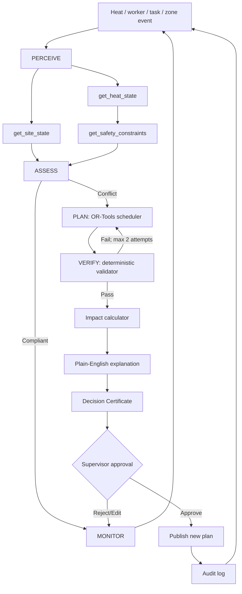

# HeatShift Supervisor architecture

## Three layers of truth

1. **Regulatory truth** — versioned deterministic rules; LLM authority = zero.
2. **Operational truth** — worker/task/site/WBGT state; LLM may read and orchestrate.
3. **Decision language** — explanations, tool selection and dialogue.

## Critic-proof statement

> Rules determine what is allowed. The optimiser finds feasible plans. The supervisor agent decides when to invoke them, coordinates tools, validates results, explains trade-offs, and stops at a human approval boundary.
